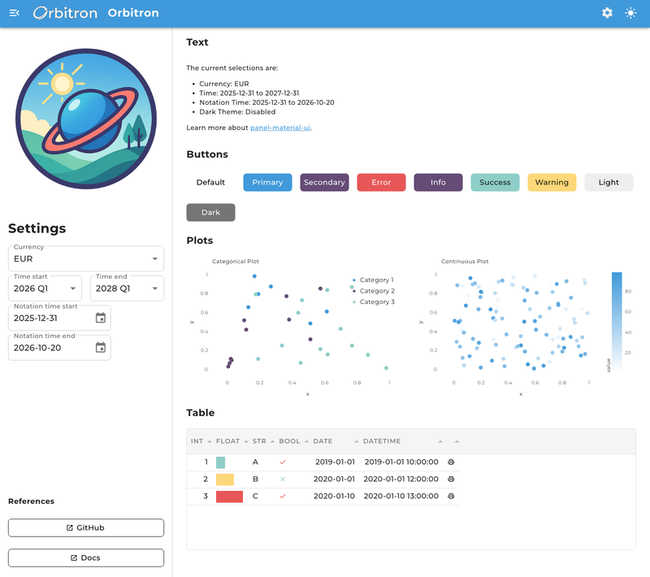

# Apply Branding

This guide shows how to create a cohesive brand experience in a `panel.ui` application, using the fictional "Orbitron" brand as an example. You will learn how to structure your brand assets, configure consistent theming and apply your brand across all components.



---

## Overview

A branded Panel application combines:

- Custom color palettes for the light and dark themes
- Typography and visual styling
- Brand asset management
- Component theming
- Layouts that keep the brand consistent

## 1. Brand architecture

Start by organizing your brand assets in a dedicated package:

```
your_app/
├── app.py                 # Main application
└── brand/                 # Brand package
    ├── __init__.py
    ├── colors.py          # Color definitions
    ├── mui.py             # Theme configuration
    └── assets/            # Brand assets
        ├── __init__.py
        ├── logo.png
        ├── favicon.ico
        └── style.css
```

This keeps your brand configuration separate from your application logic, which makes it easy to maintain, update and share between applications.

## 2. Color system

Define your brand colors in a dataclass, so they live in one place and cannot be modified by accident:

```python
# brand/colors.py
from dataclasses import dataclass

import panel as pn


@dataclass(frozen=True)
class ThemeColors:
    """Container for theme color definitions."""
    primary: str = "#4099da"
    secondary: str = "#644c76"
    success: str = "#8ecdc8"
    error: str = "#e85757"
    warning: str = "#fdd779"
    info: str = "#644c76"

# Define light and dark theme variants
LIGHT_THEME = ThemeColors()
DARK_THEME = ThemeColors(
    primary=LIGHT_THEME.secondary,
    secondary=LIGHT_THEME.primary,
)

def get_colors(dark_theme: bool = False) -> ThemeColors:
    return DARK_THEME if dark_theme else LIGHT_THEME
```

:::{note}
The theme palette expects colors as hex, `rgb()` or `hsl()` strings. CSS color names such as `"steelblue"` are not supported.
:::

Then add utility functions for your visualizations, built on the `pn.ui.theme.generate_palette` and `pn.ui.theme.linear_gradient` helpers:

```python
def get_categorical_palette(dark_theme: bool = False, n_colors: int = 20) -> list[str]:
    """Get a categorical color palette based on the theme."""
    colors = get_colors(dark_theme)
    palette = [colors.primary, colors.secondary, colors.success, colors.warning, colors.error]
    if n_colors <= len(palette):
        return palette[:n_colors]
    return pn.ui.theme.generate_palette(colors.primary, n_colors=n_colors)

def get_continuous_cmap(dark_theme: bool = False) -> list[str]:
    """Get a continuous colormap for heatmaps and gradients."""
    background = "#222222" if dark_theme else "#ffffff"
    return pn.ui.theme.linear_gradient(background, get_colors(dark_theme).primary, n=256)
```

## 3. Theme configuration

Next, build a `theme_config` for each mode from your brand colors and typography:

```python
# brand/mui.py
from copy import deepcopy

import panel as pn

from .assets import FAVICON_PATH, LOGO_PATH, RAW_CSS
from .colors import DARK_THEME, LIGHT_THEME

FONT_URL = "https://fonts.googleapis.com/css2?family=Montserrat:wght@100..900&display=swap"

LIGHT_THEME_CONFIG = {
    "palette": {
        "primary": {"main": LIGHT_THEME.primary},
        "secondary": {"main": LIGHT_THEME.secondary},
        "success": {"main": LIGHT_THEME.success},
        "error": {"main": LIGHT_THEME.error},
        "warning": {"main": LIGHT_THEME.warning},
        "info": {"main": LIGHT_THEME.info},
    },
    "typography": {
        "fontFamily": "Montserrat, 'Helvetica Neue', Arial, sans-serif",
        "fontSize": 16,
        "fontWeightRegular": 500,
        "allVariants": {"letterSpacing": "0.02em"},
    },
    "shape": {
        "borderRadius": 8,
    },
    "components": {
        "MuiButtonBase": {
            "defaultProps": {"disableRipple": True},
        },
    },
}

DARK_THEME_CONFIG = deepcopy(LIGHT_THEME_CONFIG)
DARK_THEME_CONFIG["palette"]["primary"] = {"main": DARK_THEME.primary}
DARK_THEME_CONFIG["palette"]["secondary"] = {"main": DARK_THEME.secondary}

THEME_CONFIG = {
    "light": LIGHT_THEME_CONFIG,
    "dark": DARK_THEME_CONFIG,
}
```

Typography settings that apply to all text, such as weights, go into the top-level `fontWeightLight`, `fontWeightRegular`, `fontWeightMedium` and `fontWeightBold` keys, while CSS properties like `letterSpacing` or `lineHeight` go into `allVariants`. Other top-level keys are ignored. See [Customize Typography](ui_typography) for details and [Theme Components](ui_theme_components) for the `components` key.

Now apply the configuration by changing the defaults of the `Page` and other components:

```python
@pn.cache
def configure():
    """Configure the brand for every Page in the application."""
    pn.ui.Page.param.theme_config.default = THEME_CONFIG
    pn.ui.Page.config.css_files.append(FONT_URL)

    pn.ui.Button.param.disable_elevation.default = True
```

Since the defaults are set on the classes, `configure` must only run once per process. Wrapping it in `pn.cache` ensures that the font and CSS files are not appended again for every session.

## 4. Asset management

Resolve the paths to your brand assets relative to the package, so the app works no matter which directory it is launched from:

```python
# brand/assets/__init__.py
from pathlib import Path

ROOT = Path(__file__).parent

def _absolute(path: str) -> str:
    """Convert a path relative to the assets folder to an absolute path string."""
    return str((ROOT / path).resolve())

FAVICON_PATH = _absolute("favicon.ico")
LOGO_PATH = _absolute("logo.png")

css_file = ROOT / "style.css"
RAW_CSS = css_file.read_text(encoding="utf-8") if css_file.exists() else ""
```

Then add them to `configure`:

```python
@pn.cache
def configure():
    ...
    pn.ui.Page.param.logo.default = LOGO_PATH
    pn.ui.Page.param.favicon.default = FAVICON_PATH

    if RAW_CSS:
        pn.ui.Page.config.raw_css.append(RAW_CSS)
```

The page title, which also appears in the browser tab, and other metadata are set on each `Page` with the `title` and `meta_*` arguments, e.g. `pn.ui.Page(title="Orbitron", meta_description="...")`.

## 5. Component theming

Components that are not part of `panel.ui` can be brought in line with your brand by changing their defaults as well, e.g. in `configure`:

```python
pn.pane.Image.param.stylesheets.default = ["img {border-radius: 8px}"]
pn.widgets.Tabulator.param.theme.default = "materialize"
```

## 6. State management

Use Panel's reactive system to manage the theme state across your application:

```python
import param

class AppState(pn.viewable.Viewer):
    """Application state with theme support."""

    dark_theme = param.Boolean(default=False, label="Dark Theme", allow_refs=True)
    currency = param.Selector(default="EUR", objects=["EUR", "GBP", "USD"])

    def __init__(self, **params):
        super().__init__(**params)
        # Sync with Panel's theme configuration, e.g. the ?theme=dark query parameter
        self.dark_theme = pn.config.theme == "dark"

    def __panel__(self):
        return pn.ui.Column(
            pn.ui.Switch.from_param(self.param.dark_theme),
            pn.ui.Select.from_param(self.param.currency),
        )
```

Declaring `dark_theme` with `allow_refs=True` lets you pass it a reference, e.g. the `dark_theme` parameter of the `Page`, so that it stays in sync with the page's theme toggle. This is what the layout in the next step does.

## 7. Layout

Create a consistent branded layout with a [`Page`](../../reference/templates/Page):

```python
def create_app():
    """Create the main application with a branded layout."""
    state = AppState()

    page = pn.ui.Page(
        title="Orbitron",
        sidebar=[
            pn.pane.Image(LOGO_PATH, sizing_mode="scale_width"),
            pn.ui.Column(
                "# Settings",
                state,
                "### References",
                pn.ui.Button(
                    label="Documentation",
                    href="https://panel.holoviz.org/",
                    target="_blank",
                    variant="outlined",
                ),
            ),
        ],
        sidebar_width=400,
        main=[
            pn.ui.Container(
                "## Welcome to Your Branded App",
                "Your main content goes here...",
            )
        ],
    )

    # Keep the state in sync with the page's theme toggle
    state.dark_theme = page.param.dark_theme
    return page
```

## 8. Data visualization

Plots inside a `panel.ui` app pick up your fonts and switch between light and dark mode automatically (see [Theme Plotting Libraries](ui_plotting_themes)). The colors used to draw your data are up to you, so apply your brand colors to charts and tables explicitly:

```python
import hvplot.pandas

def create_branded_chart(dark_theme: bool = False):
    """Create a chart with brand colors."""
    df = get_sample_data()
    cmap = get_categorical_palette(dark_theme=dark_theme, n_colors=3)

    return df.hvplot.scatter(
        x="x", y="y",
        color="category",
        cmap=cmap,
        height=350,
        responsive=True,
        title="Branded Chart",
    )

def create_branded_table():
    """Create a table with brand styling."""
    df = get_sample_data()

    formatters = {
        "progress": {
            "type": "progress",
            "color": [LIGHT_THEME.error, LIGHT_THEME.warning, LIGHT_THEME.success],
        }
    }

    return pn.widgets.Tabulator(
        df,
        formatters=formatters,
        sizing_mode="stretch_width",
    )
```

Here `get_sample_data` stands in for your own data loading. To switch the palette along with the theme, bind the chart function to the state, e.g. `pn.bind(create_branded_chart, dark_theme=state.param.dark_theme)`, and add the result to the page.

## 9. Deployment

Finally, configure settings that apply to the whole deployment and wire everything together in `app.py`:

```python
def configure_deployment():
    """Configure deployment-specific brand settings."""
    pn.config.disconnect_notification = (
        "Connection lost. Please refresh to reconnect to your branded app."
    )

def main():
    from brand.mui import configure

    configure()
    configure_deployment()
    create_app().servable()

if pn.state.served:
    main()
```

Run the application with:

```bash
panel serve app.py --show
```

The default theme can be overridden per visit with the `?theme=dark` URL query parameter. If your app references assets by URL rather than by path, serve the assets folder as static files with `panel serve app.py --static-dirs assets=./brand/assets`.

## Next Steps

- Customize the color palette for your brand
- Replace the example assets with your own logos and icons
- Adapt the typography to match your brand guidelines
- Extend the theme configuration for additional component customization
- Test your branded application across different screen sizes and themes

## Related Resources

- [Customize Themes & Styles](ui_themes_and_styles)
- [Customize the Palette](ui_palette)
- [Customize Typography](ui_typography)
- [Theme Components](ui_theme_components)
- [Theme Plotting Libraries](ui_plotting_themes)
