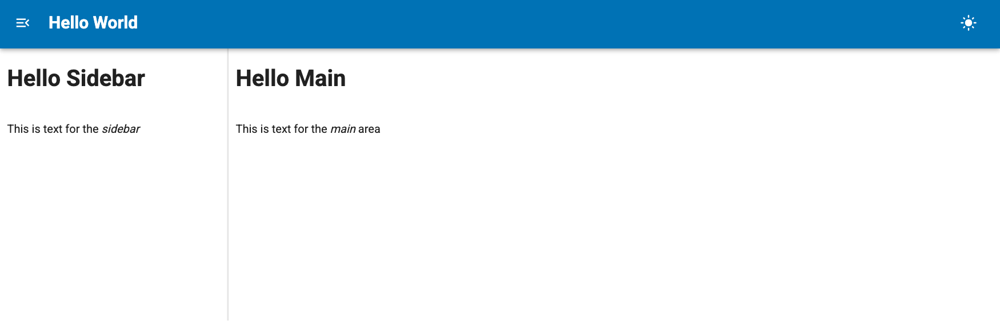
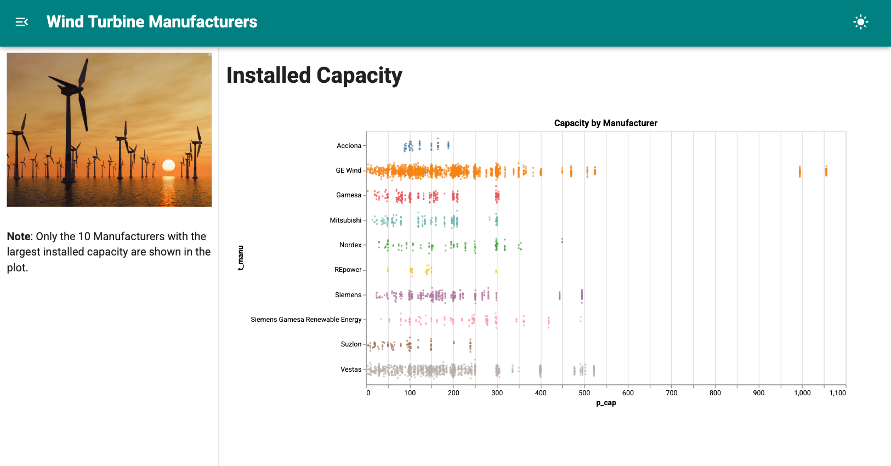
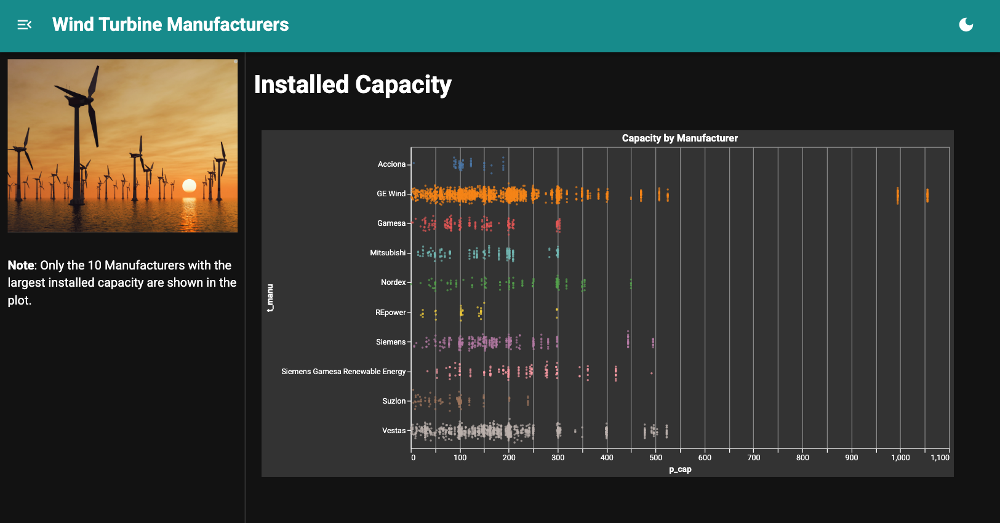

# Structure Your App with a Page

Welcome to the world of Panel pages! In this tutorial, we'll explore how to use the `Page` component to effortlessly structure your app with a header, sidebar, and main area.

A `Page` offers a streamlined approach to app layout and design, providing:

- A header with a title, an optional logo and a light/dark theme toggle.
- A collapsible sidebar for controls and a main area for your content.
- A single `theme_config` to brand the whole app with your own colors.

## Crafting a Hello World App

Let's start by creating a basic app using the [`Page`](../../reference/templates/Page.md). Copy the following code into a file named `app.py`:

```python
import panel as pn

pn.extension()

pn.ui.Page(
    title="Hello World",
    sidebar=["# Hello Sidebar", "This is text for the *sidebar*"],
    main=["# Hello Main", "This is text for the *main* area"],
).servable()
```

Serve the app with:

```bash
panel serve app.py --dev
```

It should resemble the following:



:::{note}
In the code snippet:

- `pn.ui.Page` defines the overall layout of the app.
- `title` sets the title shown in the header and in the browser tab.
- `sidebar` and `main` designate content areas for the sidebar and main section, respectively. Both take a *list* of components.

For additional configuration options, refer to the [`Page` reference guide](../../reference/templates/Page.md).
:::

:::{tip}
Panel also ships the classic templates, such as [`FastListTemplate`](../../reference/classic/templates/FastListTemplate.md) and the [`Slides`](../../reference/classic/templates/Slides.md) template, in the `pn.template` namespace.
:::

## Displaying a Page in a Notebook

A `Page` also renders inline in a notebook, so you can preview the final layout of your app while you develop it. Copy the following two code cells into a notebook:

```python
import panel as pn

pn.extension()
```

```python
pn.ui.Page(
    title="Hello World",
    sidebar=["# Hello Sidebar", "This is text for the *sidebar*"],
    main=["# Hello Main", "This is text for the *main* area"],
).servable()
```

Run the cells. The `Page` is displayed below the second cell, header, sidebar and all.

Because the `Page` is marked `.servable()`, you can also serve the notebook with `panel serve app.ipynb --dev` or open it in the *Jupyter Panel Preview*.

## Tailoring the Page

Let's customize the page further. Copy the code below into `app.py`:

```python
import altair as alt
import pandas as pd
import panel as pn

pn.extension("vega")

ACCENT = "#008080"

image = pn.ui.PNG("https://assets.holoviz.org/panel/tutorials/wind_turbines_sunset.png")

@pn.cache # Add caching to only download data once
def get_data():
    return pd.read_csv("https://assets.holoviz.org/panel/tutorials/turbines.csv.gz")

df = get_data()

top_manufacturers = (
    df.groupby("t_manu").p_cap.sum().sort_values().iloc[-10:].index.to_list()
)
df = df[df.t_manu.isin(top_manufacturers)]
fig = (
    alt.Chart(
        df.sample(5000),
        title="Capacity by Manufacturer",
    )
    .mark_circle(size=8)
    .encode(
        y="t_manu:N",
        x="p_cap:Q",
        yOffset="jitter:Q",
        color=alt.Color("t_manu:N").legend(None),
        tooltip=["t_manu", "p_cap"],
    )
    .transform_calculate(jitter="sqrt(-2*log(random()))*cos(2*PI*random())")
    .properties(
        height="container",
        width="container",
    )
)
plot = pn.ui.Vega(fig, sizing_mode="stretch_both", max_height=800, margin=20)

pn.ui.Page(
    title="Wind Turbine Manufacturers",
    sidebar=[image, "**Note**: Only the 10 Manufacturers with the largest installed capacity are shown in the plot."],
    main=["# Installed Capacity", plot],
    theme_config={"palette": {"primary": {"main": ACCENT}}},
).servable()
```

Serve the app with:

```bash
panel serve app.py --dev
```

It should appear as shown below. Try toggling the theme button in the upper right corner.



Upon toggling, the app should switch to dark mode:



:::{note}
In the code:

- `theme_config` sets the primary color of the app. The header is drawn in the primary color, and buttons, sliders and other components with `color="primary"` pick it up too. Specify colors as hex codes like `"#008080"`, CSS color names such as `"teal"` are not supported here.
- The theme toggle is built into the `Page`, so there is no need to add one yourself.
- The Altair plot switches to a dark theme together with the rest of the app. A `Page` takes care of theming Altair, Bokeh, hvPlot, Plotly and many other plots for you.
:::

## Adding to the Header

The header has room for a few compact items such as buttons or links. Let's add a link to the data source, and hide the theme toggle to keep the app in its light theme:

```python
import panel as pn

pn.extension()

source = pn.ui.Button(
    label="Data Source",
    icon="open_in_new",
    href="https://eerscmap.usgs.gov/uswtdb/",
    target="_blank",
    variant="outlined",
    color="light",
)

pn.ui.Page(
    title="Wind Turbine Manufacturers",
    header=[source],
    main=["# Installed Capacity"],
    theme_config={"palette": {"primary": {"main": "#008080"}}},
    theme_toggle=False,
).servable()
```

:::{note}
- `header` takes a list of items to display next to the title. The header is a single slim bar, so keep to buttons, links and small indicators.
- `theme_toggle=False` hides the theme toggle. Use `theme="dark"` to start the app in the dark theme instead.
:::

## Recap

In this tutorial, we've explored how to structure an app with a `Page`:

- `pn.ui.Page` gives your app a header, a sidebar and a main area.
- The `sidebar`, `main` and `header` areas take lists of components.
- A `Page` renders inline in notebooks, so you can preview your app as you build it.
- `theme_config` sets the primary color, and the built-in theme toggle switches between light and dark.
- The classic templates, like `FastListTemplate`, are still available in the `pn.template` namespace.

## References

### Component Gallery

- [Page](../../reference/templates/Page.md)
- [ThemeToggle](../../reference/templates/ThemeToggle.md)
- [AppBar](../../reference/templates/AppBar.md)

### How-to Guides

- [Arrange Components in a Template](../../how_to/templates/template_arrange.md)
- [Set a Template](../../how_to/templates/template_set.md)
- [Style Altair Plots](../../how_to/styling/altair.md)

### Explanations

- [Templates Overview](../../explanation/styling/templates_overview.md)
